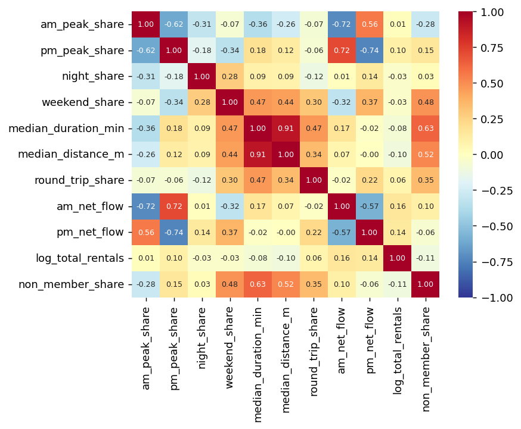
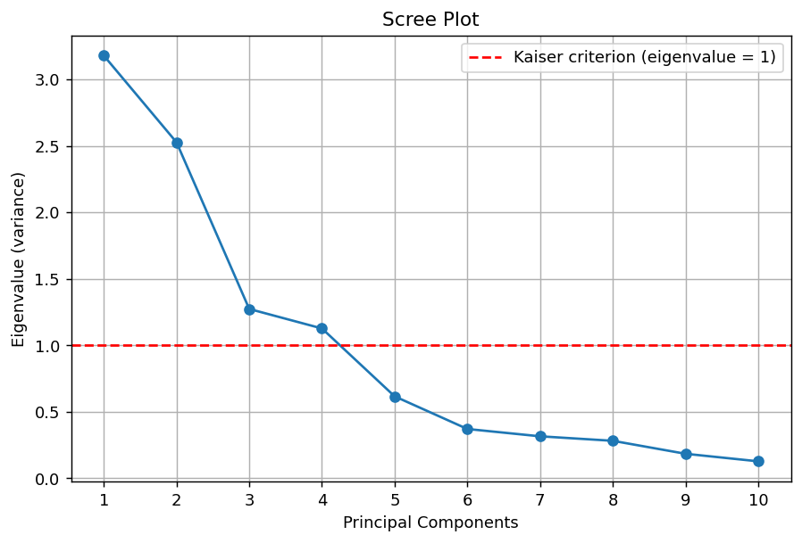
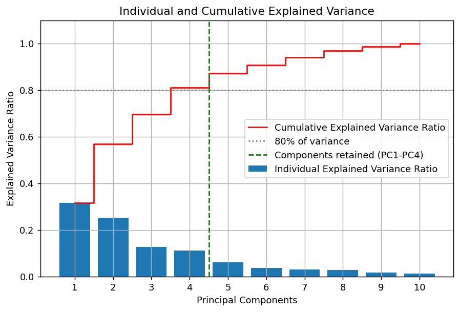
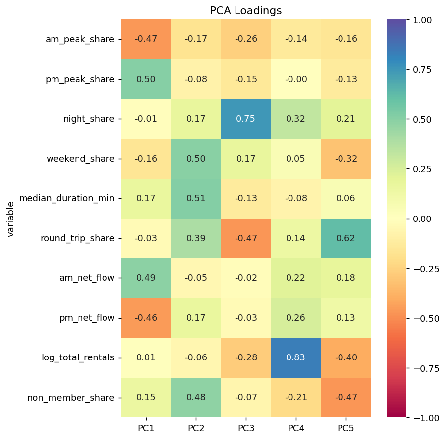
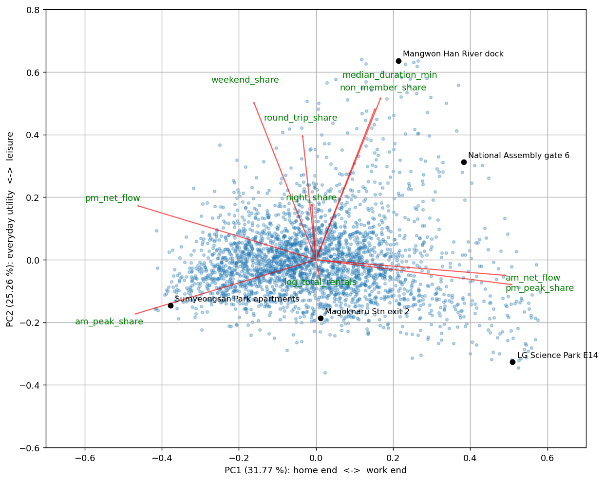

### Session 2: Principal Component Analysis (PCA)

**Goal:** many of our station features overlap. For example, stations with a high weekend share also tend to have long round trips. PCA combines correlated features into a smaller number of uncorrelated components that describe the main directions in which stations differ. These components are the input for the clustering step.

Code: [Bike-S.ipynb](https://github.com/DaeYeong-Mun/CDS-303-Final-project/blob/main/notebooks/Bike-S.ipynb) (sections "Station-Level Behaviour Features" and "Principal Component Analysis"), following CDS 303 Demo 6.

---

## 1. Input Variables and Preprocessing

### Variables

All variables are computed per rental station from the 18,511,943 trips (January–June 2026). We start with 11 candidate variables that describe **how** a station is used.

| Group | Variable | Definition |
|---|---|---|
| Time of day | `am_peak_share` | Weekday rentals 07:00–09:59 ÷ weekday rentals |
| | `pm_peak_share` | Weekday rentals 17:00–19:59 ÷ weekday rentals |
| | `night_share` | Rentals 22:00–04:59 ÷ total rentals |
| | `weekend_share` | Saturday/Sunday rentals ÷ total rentals |
| Trip type | `median_duration_min` | Median trip duration (minutes) |
| | `median_distance_m` | Median trip distance (meters), **dropped** (see below) |
| | `round_trip_share` | Trips returned to the same station ÷ total rentals |
| Bike flow | `am_net_flow` | (returns − rentals) ÷ (returns + rentals), weekday 07:00–09:59 |
| | `pm_net_flow` | Same, weekday 17:00–19:59 |
| Station size | `log_total_rentals` | log10 of total rentals |
| Rider mix | `non_member_share` | Rentals by non-members (tourists, one-off users) ÷ total rentals |

Net flow is split into morning and evening because a single daily net flow hides the commute: morning outflows and evening inflows cancel out (the overall median is about 0). Spatial context (subway distance, bike paths, district) is left out on purpose. It is kept for the later classification step, which explains the clusters, so that the explanation is not circular.

**Why weather is not included.** Our first PCA also used two weather-sensitivity ratios (rentals on cold days and on rainy days compared with normal days). We removed them because linking daily weather to station summaries is temporally tricky:

- All 32 days below 0 °C fall in January–February, while ridership rises steadily into spring. Lower use on cold days is therefore partly a winter-vs-spring effect, not only a temperature effect.
- Lunar New Year falls in the same period and lowers commuter trips for reasons unrelated to weather.
- Daily precipitation does not show *when* it rained, and there is only one citywide weather station.
- In that first run, rain sensitivity formed a component almost on its own, and cold sensitivity mostly duplicated the leisure pattern.

Weather sensitivity is still part of our research question. It will be analysed **after** clustering, by modelling each cluster's daily rentals against temperature and rain while controlling for month, day of week and public holidays.

### Preprocessing

1. **Low-volume stations:** the 30 stations with fewer than 50 rentals in six months are removed, because their shares are based on too few trips (many are exactly 0 or 1). This leaves **2,777 stations**.
2. **Missing values:** after this filter, none of the variables has missing values, so no imputation is needed. Trips without a return station (about 0.5%) are left out of the return-based features only.
3. **Redundant variables:** median duration and median distance are almost the same measurement (r = 0.91), so `median_distance_m` is dropped. No other pair exceeds |r| = 0.74. This leaves **10 variables**.
4. **Outliers:** several variables are strongly right-skewed (e.g. `round_trip_share` and `non_member_share` both have a skew of about 4.4). Each variable is clipped at its 1st and 99th percentiles so a handful of extreme stations cannot dominate a component.
5. **Measurement scale:** the variables are in different units (minutes, proportions, net flow from −1 to 1, log counts). PCA is driven by variance, so all variables are standardized with `StandardScaler` (mean 0, standard deviation 1).

---

## 2. Component Selection

| Component | Eigenvalue | Explained variance | Cumulative |
|---|---|---|---|
| PC1 | 3.18 | 31.8% | 31.8% |
| PC2 | 2.53 | 25.3% | 57.0% |
| PC3 | 1.27 | 12.7% | 69.8% |
| PC4 | 1.13 | 11.3% | **81.0%** |
| PC5 | 0.62 | 6.2% | 87.2% |
| PC6 | 0.37 | 3.7% | 90.9% |
| PC7 | 0.32 | 3.2% | 94.1% |
| PC8 | 0.28 | 2.8% | 96.9% |
| PC9 | 0.18 | 1.8% | 98.7% |
| PC10 | 0.13 | 1.3% | 100% |

**We keep 4 components.** Three common rules all point to the same answer:

- **Kaiser criterion:** exactly four components have eigenvalues above 1. PC5 is well below (0.62).
- **Cumulative variance:** four components explain **81.0%** of the variance, above the commonly used 80% threshold, while reducing 10 variables to 4.
- **Scree plot:** there are clear drops after PC2 (2.53 → 1.27) and after PC4 (1.13 → 0.62). After PC4 the curve is flat, and each further component adds 6% or less.

---

## 3. Component Interpretation

The sign of a component is arbitrary, so each component is oriented so that a reference variable has a positive loading (`pm_peak_share` for PC1, `weekend_share` for PC2, `night_share` for PC3, `log_total_rentals` for PC4). This does not change the results.

| Component | Strongest contributors (\|loading\| ≥ 0.3) | Interpretation |
|---|---|---|
| **PC1** (31.8%) | `pm_peak_share` (+0.50), `am_net_flow` (+0.49), `am_peak_share` (−0.47), `pm_net_flow` (−0.46) | Home end vs. work end of the commute |
| **PC2** (25.3%) | `median_duration_min` (+0.51), `weekend_share` (+0.50), `non_member_share` (+0.48), `round_trip_share` (+0.39) | Leisure vs. everyday utility |
| **PC3** (12.7%) | `night_share` (+0.75), `round_trip_share` (−0.47) | Night-time use |
| **PC4** (11.3%) | `log_total_rentals` (+0.83), `night_share` (+0.32) | Station size |

**PC1: Home end vs. work end.** A high score means bikes arrive in the morning and leave in the evening. The highest-scoring stations are offices and financial institutions in Yeouido and the Gasan Digital Complex (Korea Development Bank, the Financial Supervisory Service, World Meridian Venture Center). A low score means the reverse, the pattern of residential areas: the lowest-scoring stations are almost all apartment complexes.

**PC2: Leisure vs. everyday utility.** A high score means long weekend round trips, often by casual riders. The highest scores are Han River stations (the Mangwon, Ttukseom and Yeouido ferry docks). The lowest scores are corporate campuses in Magok (LG Science Park, Lotte R&D Center), where trips are short, on weekdays, and made by regular members.

**PC3: Night-time use.** High scores are stations used late at night, such as Itaewon Station exit 3 and Hansung University Station exit 7. Low scores are daytime park and neighbourhood stations such as World Cup Park.

**PC4: Station size.** This separates very busy stations (e.g. Sillim Station exit 8, Omokgyo Station exit 3) from quiet ones, independently of how they are used.

These descriptions explain what high and low scores mean, using the most extreme stations as examples. Each component is a continuous direction along which stations vary. It does not divide stations into groups.

---

## 4. Visualization and Discussion

Each point is a station and each red arrow is a variable. An arrow's direction shows which way that variable increases, and its length shows how strongly it contributes to PC1 and PC2.

**How to read this plot.** PCA identifies directions of variation, not clusters, so any visual groupings in the scatter are not confirmed station types. The plot shows only PC1 and PC2 (57.0% of the variance). Four components are retained (81.0%), so PC3 and PC4 are not visible here: two stations that look close in this plot can still differ on night-time use or size.

**Visible patterns**

- **The commute direction (PC1).** `am_peak_share` and `pm_net_flow` point left, while `pm_peak_share` and `am_net_flow` point right. These are two sides of the same daily cycle: stations further left lose bikes in the morning and regain them in the evening, and stations further right do the reverse.
- **The leisure direction (PC2).** `weekend_share`, `median_duration_min`, `non_member_share` and `round_trip_share` point up. The Mangwon Han River dock is at the very top.
- **The two directions combine.** The National Assembly gate is high on both PC1 (a workplace on weekdays) and PC2 (next to Yeouido Han River Park). Magoknaru Station exit 2, a busy transfer point, is near zero on PC1 because bikes flow both in and out at each peak.
- **Uneven spread.** Most stations are concentrated near the centre and left. Fewer extend far to the right or toward the top (122 stations score above 3 on PC2, mostly by the river). The points form a continuous spread without clear gaps, so this plot alone does not show separate groups.

**Relation to the research question.** We ask what distinct usage profiles Ttareungi stations show and which characteristics best explain them. PCA does not answer the first part on its own, since it finds directions rather than profiles. It does show which characteristics drive the differences between stations: mainly where a station sits in the daily commute (PC1) and whether it serves leisure or everyday trips (PC2), which together explain 57% of the variation. Night-time use (PC3) and station size (PC4) bring this to 81%. These four directions are where the clustering step will look for distinct profiles.

**Intended audience: Seoul Facilities Corporation, which operates Ttareungi.** Each direction relates to an operational question:

- **PC1 (home ↔ work), rebalancing:** stations at opposite ends empty and fill in opposite directions each day, so bikes need to be moved from high-PC1 back toward low-PC1 stations before the morning peak.
- **PC2 (leisure ↔ utility), timing of demand:** high-PC2 stations such as the Han River docks need bikes on weekends, while low-PC2 stations need them on weekday mornings and evenings.
- **PC4 (size), capacity:** how many bikes and docks a station needs, independently of how it is used.

**Next step.** The four component scores (81.0% of the variance) are the input for clustering. Because they are standardized and uncorrelated, distance-based methods such as k-means treat each direction fairly. The clusters will then be explained with a classifier and SHAP values, and each cluster's weather sensitivity will be measured with a daily model.

**Limitations**

- The data covers January–June only, so the summer peak and July monsoon are missing, and summarising six months into one row per station hides seasonal changes in how a station is used.
- `non_member_share` and `round_trip_share` remain right-skewed after clipping, so a few leisure stations still strongly influence PC2.
- PCA finds linear combinations only. Non-linear patterns will need to be checked in the clustering step.
